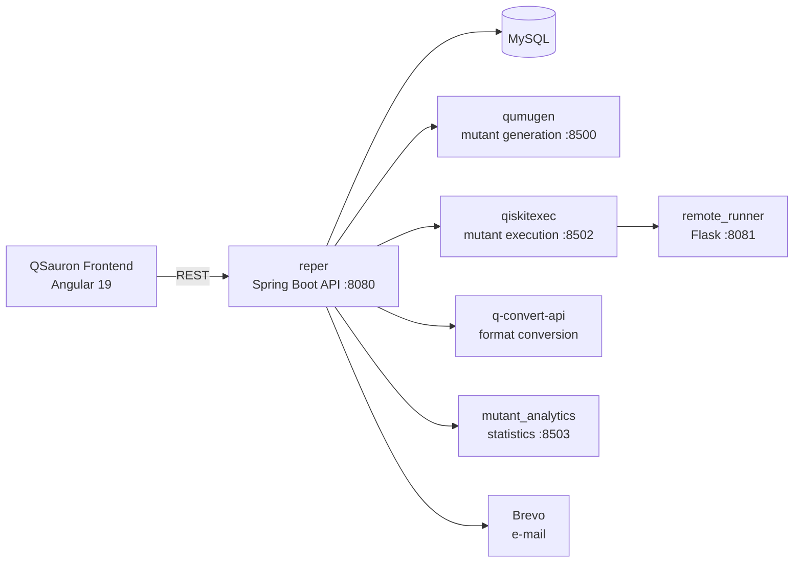

  

# QSauron

> Mutation testing for quantum programs: generate mutants of a circuit, execute them and find out which ones your tests can kill.

## What is in this repository

| Path | Description |
|---|---|
| [`reper/`](reper/README.md) | Spring Boot backend (API, persistence, experiment orchestration) |
| [`Operadores.sql`](Operadores.sql) | Seed data for mutation operators and their families |
| [`plantuml_export.puml`](plantuml_export.puml) | PlantUML class diagram of generators and related entities |
| [`reper/docs/`](reper/docs) | API reference, data model and generator message formats |

Start with the [reper README](reper/README.md).

## QSauron ecosystem

Ports are the defaults found in the code and may differ per deployment.

| Repository | Role |
|---|---|
| [QSauron (this repo)](https://github.com/AlarcosQuantumTesting/QSauron) | `reper` API and persistence |
| [QSauron Frontend](https://github.com/SamRo28/QSauron) | Angular 19 web client |
| [Qumuclient](https://github.com/SamRo28/Qumuclient) | Original UI plus `qumugen` and `qiskitexec` |
| [q-convert-api](https://github.com/SamRo28/q-convert-api) | REST wrapper around the `q-convert` CLI |
| [QuCo `remote_runner`](https://github.com/AlarcosQuantumTesting/QuCo) | Remote execution of Qiskit/Cirq programs |

## License

[MIT](LICENSE)
