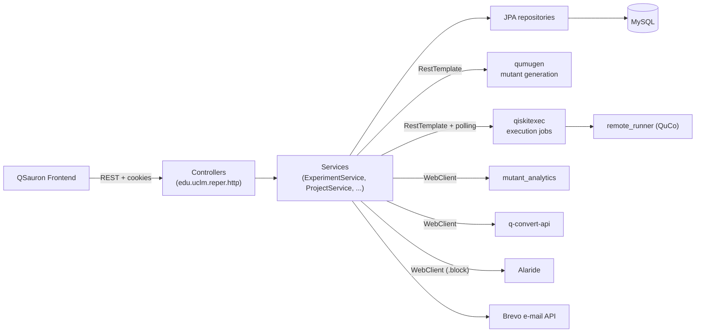
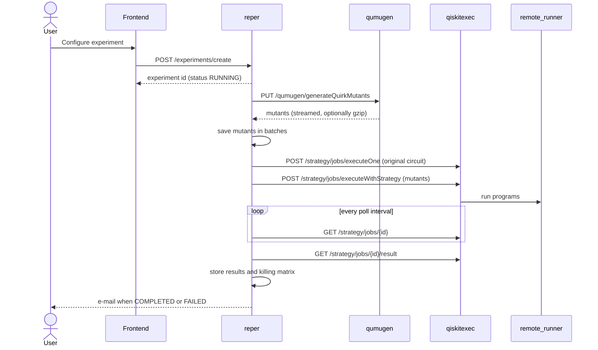

<p align="center">
  
</p>

# reper — QSauron backend

> The REST API behind QSauron: users, projects, mutation experiments and results for quantum circuits, orchestrating mutant generation, execution, statistics and format conversion.


## Table of contents

- [Overview](#overview)
- [Features](#features)
- [Architecture](#architecture)
- [Getting started](#getting-started)
- [Configuration](#configuration)
- [Usage](#usage)
- [Project structure](#project-structure)
- [Testing](#testing)
- [Documentation](#documentation)
- [Roadmap](#roadmap)
- [License](#license)

## Overview

Mutation testing checks the quality of a test suite by injecting small faults (*mutants*) into a program and measuring how many the tests detect. For quantum circuits this means generating mutated circuits, running them on simulators or hardware and building a *killing matrix* of mutants versus test cases.

`reper` is the central service: it stores everything, drives the long-running experiment pipeline, and exposes it to the [QSauron frontend](https://github.com/SamRo28/QSauron).

## Features

- **Accounts and security** — registration, login, 2FA, password recovery by e-mail, HttpOnly session/refresh cookies.
- **Projects** — create, import (multiple circuit formats, with size and qubit limits) and share circuit projects.
- **Experiments** — asynchronous pipeline: generate mutants → execute them → store the killing matrix; progress tracking, resume of failed runs, merge of experiments, e-mail notification.
- **Statistics** — delegates cycle statistics to the `mutant_analytics` service as a background job.
- **Format conversion** — catalogue and conversion endpoints backed by [q-convert-api](https://github.com/SamRo28/q-convert-api).
- **Generators** — Grenoble, Matrix, Genetic, Grover, Blocks and Editor strategies ([formats](docs/MESSAGE_FORMATS.md)).

## Architecture



### Experiment pipeline

`ExperimentService` runs experiments in the background. Execution in `qiskitexec` is asynchronous: `reper` submits a job and polls its status.



Latency of each mutant is bounded by the properties `app.qiskitexec.read-timeout-seconds`, `app.qiskitexec.poll-interval-ms`, `app.qiskitexec.batch-size`, `app.qiskitexec.runner-workers` and `app.qiskitexec.target-request-seconds`. The `Alaride` proxy uses blocking WebClient calls (`.block()`): keep that in mind when tuning thread pools and timeouts.

## Getting started

### Prerequisites

- Java 21
- Maven 3.9+
- MySQL 8 with an empty schema named `qsauron`
- (Optional) the downstream services listed in [Configuration](#configuration)

### Install and run

```bash
git clone git@github.com:AlarcosQuantumTesting/QSauron.git
cd QSauron/reper
cp src/main/resources/application-local.properties.example src/main/resources/application-local.properties
# edit the file: database, downstream URLs, e-mail API
mvn spring-boot:run -Dspring-boot.run.profiles=local
```

The API listens on `http://localhost:8080`. Note that `application.properties` selects the `prod` profile by default, so always pass the profile you want.

Seed the mutation operators once the tables exist:

```bash
mysql -u <user> -p qsauron < ../Operadores.sql
```

### Build and deploy

The project is packaged as a **WAR** (`<packaging>war</packaging>`, Tomcat provided by the container):

```bash
mvn clean package
# deploy target/qsauron-1.0.0.war to your servlet container
```

## Configuration

Profiles: `local`, `test`, `prod` (`src/main/resources/application-*.properties`). Real values stay out of git; this table lists property **names** only. A template is in [`application-local.properties.example`](src/main/resources/application-local.properties.example).

| Property | Purpose |
|---|---|
| `spring.datasource.url` / `.username` / `.password` | MySQL connection |
| `app.cors.allowed-origins` | Allowed front-end origins |
| `app.qumugen.url` | Mutant generation service (default `http://localhost:8500`) |
| `app.qiskitexec.url` | Execution service (default `http://localhost:8502`) |
| `app.qiskitexec.batch-size`, `.max-programs-per-request`, `.runner-workers`, `.target-request-seconds`, `.read-timeout-seconds`, `.poll-interval-ms` | Execution batching, parallelism and timeouts |
| `app.mutantanalytics.url`, `app.mutantanalytics.timeout-minutes` | Statistics service and its timeout |
| `app.qconvert.url`, `.timeout-seconds`, `.max-request-bytes` | q-convert-api client |
| `app.converter.url` | Converter endpoint |
| `app.alaride.url` | Alaride service |
| `app.import.max-files`, `.max-file-bytes`, `.max-total-bytes`, `.max-request-bytes`, `.max-qubits` | Project import limits |
| `brevo.api.key`, `brevo.api.url`, `brevo.sender.email`, `brevo.sender.name` | Transactional e-mail |
| `spring.servlet.multipart.max-file-size`, `.max-request-size` | Upload limits |
| `server.shutdown`, `spring.lifecycle.timeout-per-shutdown-phase` | Graceful shutdown |

## Usage

Log in (the response sets the session cookies), then call any endpoint with the cookie jar:

```bash
curl -i -c cookies.txt -H "Content-Type: application/json" \
  -d '{"email":"user@example.com","pwd":"<password>"}' \
  http://localhost:8080/users/login

curl -b cookies.txt -H "Content-Type: application/json" \
  -d '{"email":"user@example.com"}' \
  http://localhost:8080/projects/getAllByUserSummary
```

The full endpoint list is in [`docs/API.md`](docs/API.md).


## Project structure

```text
reper/
├── src/main/java/edu/uclm/reper/
│   ├── http/          # REST controllers and proxies (Alaride, q-convert, mutant_analytics)
│   ├── services/      # ExperimentService, ProjectService, BackgroundJobService, ...
│   ├── model/         # JPA entities and generators
│   ├── repository/    # Spring Data repositories
│   ├── dto/           # Request/response objects
│   └── config/        # CORS, compression, import size filter
├── src/main/resources/  # profiles, e-mail templates, demo.json (demo project)
├── src/test/java/       # unit tests
└── docs/                # API, data model, message formats
```

## Testing

```bash
mvn test
```

## Documentation

- [REST API](docs/API.md)
- [Data model](docs/DATA_MODEL.md)
- [Generator message formats](docs/MESSAGE_FORMATS.md)

## Roadmap

- [ ] OpenAPI / Swagger documentation
- [ ] Review session checks on `/qucoreper/getcircuit` and `/qucoreper/savecircuit`
- [ ] Reduce blocking calls in the Alaride proxy
- [ ] Container image and compose file

## License

[MIT](../LICENSE)
