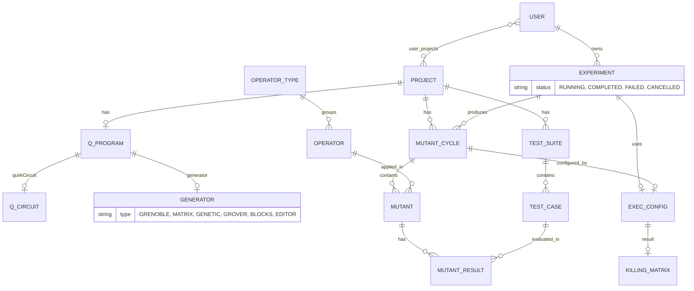

# Data model

Persistence uses JPA/Hibernate on MySQL (schema `qsauron`). Entities live in `reper/src/main/java/edu/uclm/reper/model/`.



The relations above are derived from the JPA annotations; check the entity classes for cascade and fetch details. `MutantCycle` and `MutantResult` use composite identifiers.

## Initial data

`Operadores.sql` (repository root) seeds `qsauron.operator_types` (families: Initialization errors, Control Gates, Swap Gates, Position errors, Other operators, Phase Gates) and `qsauron.operators` (name, description, enabled flag, family). Run it once on a fresh database, after Hibernate has created the tables:

```bash
mysql -u <user> -p qsauron < Operadores.sql
```

`plantuml_export.puml` (repository root) is a PlantUML class diagram of the generator hierarchy and related entities.
